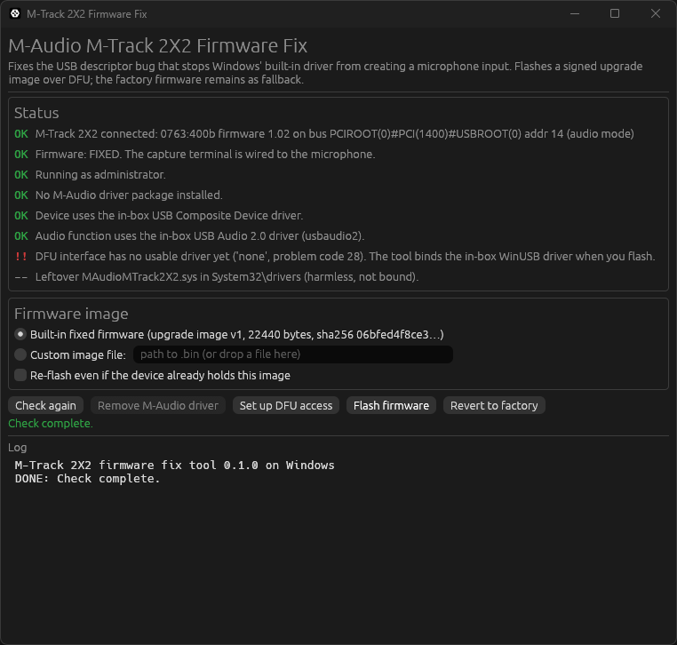

# M-Audio M-Track 2X2: microphone fix for Windows

A small tool that fixes a firmware bug in the **M-Audio M-Track 2X2** audio interface so that its
microphone input works with the USB audio driver built into Windows. No vendor driver needed.



## Read this first

- **This is only for the M-Track 2X2** (the C-series model with a USB-C socket, USB ID `0763:400b`).
  It is **not** for the M-Track 2X2M, the M-Track Solo, the M-Track Duo or any other model.
  The tool checks the USB ID and refuses other devices, but please check the label on your unit too.
- It was made to fix **my own unit**, which reports firmware version `1.02`. Other units may differ.
  The tool reads your device first and tells you whether the bug is present before it changes anything.
- The fix only matters on **Windows** with the built-in driver. **Linux already works** with no changes.
- The fix is written to a spare slot in the device. The original factory firmware stays on the chip
  and the device falls back to it if anything is wrong. The tool can also undo the fix at any time.

## The problem in one paragraph

The device describes itself to the computer over USB. In that description, the recording channel
is pointed at the wrong source (the playback stream instead of the microphone). Linux ignores that
part of the description and works anyway. Windows' built-in USB Audio 2.0 driver believes it, finds
no microphone and creates only a "Speakers" device. M-Audio's own Windows driver works around this,
but it is from 2021 and takes over the whole device. The fix is a single byte in the firmware.
Details: [docs/the-problem.md](docs/the-problem.md).

## Download

Ready-made builds for Windows and Linux will be on the
[releases page](https://github.com/nmjbhoffmann/m-audio2x2/releases) (coming soon). Until then,
see "Build it yourself" below.

## How to use (Windows)

1. If you ever installed the M-Audio driver, remove it: start `mtrack-fix.exe`, click
   **Remove M-Audio driver**, reboot, then unplug and replug the interface.
2. Start `mtrack-fix.exe` again (it asks for administrator rights). Read the status list.
   It should say the firmware has the bug and that Windows' own drivers are in use.
3. Click **Flash firmware**. The tool gives itself access to the device, switches it to update
   mode, writes the fix and switches back. This takes under a minute. Follow any unplug/replug
   prompt in the yellow banner.
4. Check Windows' sound settings: a **Microphone (M-Track 2X2)** recording device now exists.

Full instructions, the Linux steps and troubleshooting: [docs/using-the-tool.md](docs/using-the-tool.md).

To undo the fix, click **Revert to factory**.

## Build it yourself

Install Rust from <https://rustup.rs>, then:

**Windows** (needs Visual Studio Build Tools with the "Desktop development with C++" workload)

```
cd tool
cargo build --release
```

**Ubuntu / Debian**

```
sudo apt install build-essential libxkbcommon-dev libwayland-dev libxcb1-dev libxrandr-dev libxi-dev libgl1-mesa-dev libudev-dev
cd tool
cargo build --release
```

**Fedora**

```
sudo dnf install gcc libxkbcommon-devel wayland-devel libxcb-devel libXrandr-devel libXi-devel mesa-libGL-devel systemd-devel
cd tool
cargo build --release
```

The program is `tool/target/release/mtrack-fix` (`mtrack-fix.exe` on Windows). The fixed firmware
is built into it. More in [docs/building.md](docs/building.md).

## Documentation

| Where | What |
|---|---|
| [docs/README.md](docs/README.md) | Index of all documents |
| [docs/the-problem.md](docs/the-problem.md) | What is wrong and what the fix changes |
| [docs/using-the-tool.md](docs/using-the-tool.md) | Step by step for Windows and Linux, troubleshooting |
| [docs/building.md](docs/building.md) | Building from source |
| [docs/technical/](docs/README.md#technical) | Hardware, USB descriptors, firmware format, DFU, Windows and Linux driver details |
| [firmware/README.md](firmware/README.md) | The firmware images, their checksums and what they are |
| [tool/README.md](tool/README.md) | The tool's own README (features, command line, code layout) |

## Credits

The research, troubleshooting and nearly all of the code and documentation in this repository
were done with Claude (Anthropic's AI), driven and tested by the author on their own unit.

## License

Code and docs: MIT. Firmware images: not covered, see [LICENSE](LICENSE) and
[firmware/README.md](firmware/README.md). This project is not affiliated with M-Audio or inMusic.
Use at your own risk.
