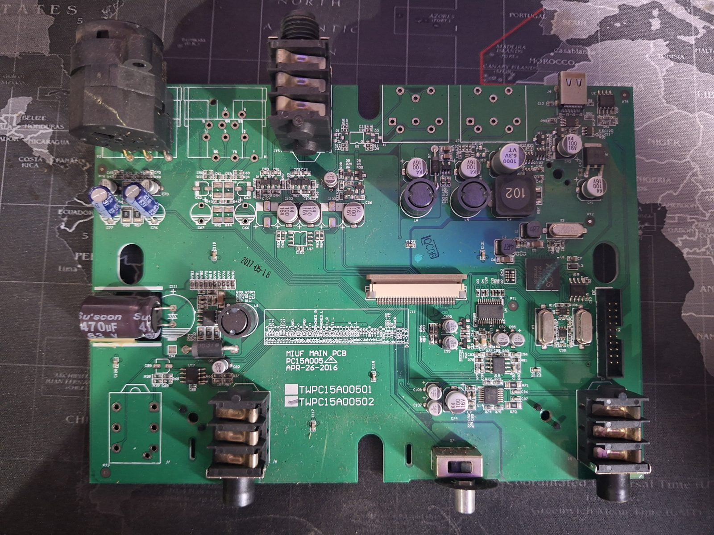
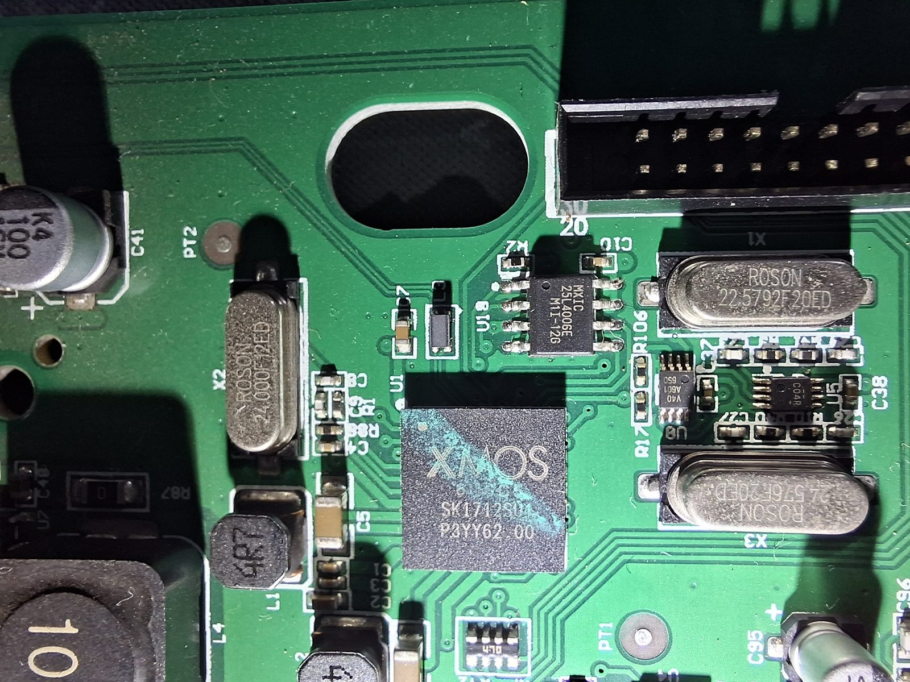
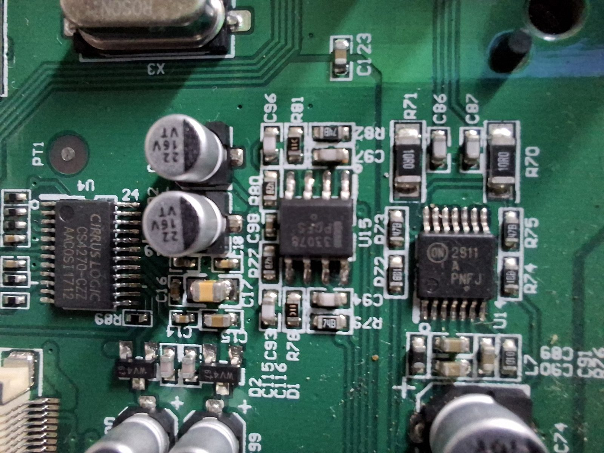
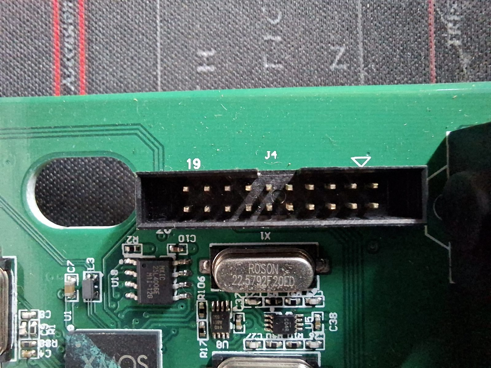

# Hardware

What is inside the M-Track 2X2, and how to read or write its firmware flash directly. Board
photos are from the author's unit, opened on 2026-11-04. The sister model (M-Track 2X2M) has a
public teardown with the same chip family, so the design is shared across the C-series.

## Identification

| Field | Value |
|---|---|
| Product | M-Audio M-Track 2X2 (C-series, USB-C socket). Not the 2X2M (MIDI variant). |
| USB VID:PID | `0763:400b` (audio mode), `0763:c00b` (DFU mode) |
| Firmware / device revision | `bcdDevice 1.02` |
| Serial number | none (iSerial 0) |
| USB | High speed (480 Mb/s), bus powered, declares 500 mA |
| Audio class | USB Audio Class 2.0, one Interface Association; plus a DFU 1.1 interface |
| Board | "MIUF MAIN PCB PC15A005 APR-26-2016", TWPC15A00501/02 |

## Main parts

| Part | Reference | Notes |
|---|---|---|
| **XMOS XS1-U8A** xCORE (USB-capable XS1-U series), BGA | U1 area, large chip marked "XMOS" | Runs a lightly modified XMOS USB Audio reference firmware (`sc_usb_audio` / early `lib_xua`). Entity IDs, DFU layout and a leftover "iAP Interface" string all match the XMOS reference design. |
| **Macronix MX25L4006E** 4 Mbit (512 KiB) SPI NOR flash, SOIC-8 | U19, right next to the XMOS chip | Holds the boot loader, the factory firmware image and the optional upgrade image. JEDEC ID `C2 20 13`. |
| **Cirrus Logic CS4270-CZZ** 24-bit / 192 kHz stereo codec | U4 | DAC and ADC in one chip, driven over I2S (and probably I2C) by the XMOS chip. Not visible over USB. |
| 24.000 MHz crystal | X2 | XMOS system clock |
| 22.5792 MHz crystal | X3 | Master clock for the 44.1 kHz rate family |
| 24.576 MHz crystal | X1 | Master clock for the 48 kHz rate family |
| 20-way 2x10 box header | J4 | XMOS xSYS debug connector (JTAG and UART for an xTAG adapter). Pin 1 at the triangle, at the end away from the flash chip. Even pins are ground; pin 15 is `RST_N`. |
| 50-way FFC | J11 | To the front-panel board (inputs, +48 V enable, LEDs). The pinout is printed on the board. |
| Preamps | front board | Marketed as "Crystal" preamps; parts not identified. |

Everything the host sees is the XMOS firmware's USB Audio 2.0 implementation. The codec never
appears over USB. There are no USB volume, mute or gain controls; the knobs are analog.

One clock fact matters for drivers: both crystals feed a **single** audio master clock, and the one
CS4270 runs its DAC and ADC from it. Playback and capture therefore always run at the same sample
rate. See [linux.md](linux.md) for the consequence.

## Photos

Main board, top side. USB-C at top right, J4 debug header at the right edge, the XMOS chip and
flash near the centre right, codec lower centre:

XMOS chip with the MX25L4006E flash (U19) directly above it and the three crystals:

The CS4270 codec (U4):

J4, the xSYS header, with the flash chip and the 22.5792 MHz crystal below it:

## Reading the flash with an SPI programmer

The DFU interface cannot read the factory image (see [dfu.md](dfu.md)), so the only way to get the
original firmware bytes is to read the flash chip itself. Any ordinary SPI / EEPROM programmer that
knows the MX25L4006E works: a CH341A with a SOIC-8 test clip, a Raspberry Pi, a Bus Pirate, and so
on. `flashrom` supports the chip (`flashrom -p ch341a_spi -r dump.bin`).

Pinout of U19 (standard SOIC-8 SPI NOR, pin 1 at the dot):

| Pin | Name | Pin | Name |
|---|---|---|---|
| 1 | CS# | 8 | VCC (3.3 V) |
| 2 | SO (MISO) | 7 | HOLD# |
| 3 | WP# | 6 | SCLK |
| 4 | GND | 5 | SI (MOSI) |

Two ways to do it:

1. **Desoldered.** Lift the chip, read it in the programmer's socket, solder it back. No bus
   contention, no surprises. Hot air and a steady hand needed.
2. **In circuit with a clip.** Works, but the XMOS chip shares the SPI lines. When the board's 3.3 V
   rail comes up (from USB or back-fed by the programmer), the XMOS boots and drives the bus, and the
   read returns garbage or the lines sit at odd voltages. Hold the XMOS in reset first: a jumper
   between **J4 pins 15 (`RST_N`) and 16 (GND)** keeps it from booting and leaves its SPI pins
   floating. Then either power the board from USB (it will not enumerate while held in reset, which is
   the point) and leave the programmer's VCC unconnected, or power the chip from the programmer with
   the board unplugged. The first way is more reliable on this board.

Checks that the read is good: the JEDEC ID reads `C2 20 13`; two consecutive full reads are
byte-identical; and after bit reversal (next section) the image header described in
[firmware-format.md](firmware-format.md) parses with matching CRCs.

Keep the first dump forever. It is the only complete backup of the boot loader and the factory image.

## Bytes are stored bit-reversed

A raw dump looks like nonsense. The XS1 boot ROM clocks the SPI bus **LSB first**, and `xflash`
writes images in that bit order, so every byte in the chip is the mirror image of the logical byte
(`0x01` is stored as `0x80`, `0x0F` as `0xF0`, and so on). A normal programmer reads MSB first and
returns the mirrored bytes.

To get the logical image: reverse the bits of **every byte** (`b -> int(f"{b:08b}"[::-1], 2)` in
Python). To write an image with a programmer: reverse it back first. The DFU interface moves bytes
verbatim, so a file sent over DFU must also be in chip order (bit-reversed). The tool does this
itself.

## Flash layout (as found on the author's unit)

Offsets are chip offsets; contents are described in logical order.

| Offset | Size | Contents |
|---|---|---|
| `0x0000` | 4 B | Length word of the first-stage loader (554 words) |
| `0x0004` | 2216 B | First-stage flash loader (ROM boot image), XS1 code. Contains its own copy of the LZ decompressor and the CRC check for the factory image. |
| `0x08AC` | 4 B | CRC word checked by the boot ROM |
| `0x08B0` | 22440 B | **Factory image**: xflash image header (tag `0x0FF51DE`, version 0) + compressed program. Ends at `0x6058`, page-padded to `0x6100`. |
| `0x6100` | | Erased (`0xFF`) |
| `0x7000` | up to 128 KiB | **Upgrade image slot.** The first 4 KiB sector boundary after the factory image. This is where the firmware's DFU code writes an upgrade image and where the loader looks for one. Empty from the factory; holds the version-1 fix after the tool has run. |
| rest to `0x80000` | | Erased (`0xFF`) |

Notes:

- The loader looks for the upgrade image **only at the sector boundary after the factory image**.
  An image placed anywhere else (`0x10000` was tried) is ignored, and leaving a stray image there
  also made DFU mode unreliable. If you write with a programmer, write to `0x7000` exactly, erase
  everything after the image, and never leave a second copy elsewhere.
- Writing with a programmer: erase 4 KiB sectors from `0x7000` up, program the bit-reversed image at
  `0x7000`, pad with zeros to the end of the last 256-byte page. That is byte-for-byte what the
  device's own DFU code does.
- Erasing the sectors from `0x7000` up with a programmer is equivalent to the DFU "revert factory"
  request.

## What the J4 header offers

With an XMOS xTAG-3 or xTAG-4 adapter and the XMOS tools, `xflash --read-all` dumps the whole chip
through the XMOS chip itself (no bus contention), and `xflash` can write factory or upgrade images
and recover a unit with a damaged boot loader. The XS1-U series needs an older toolchain release that
still supports XS1 (xTIMEcomposer 14.x). This route was not used for this project because of the
cost of the adapter, but it is the cleanest one.
